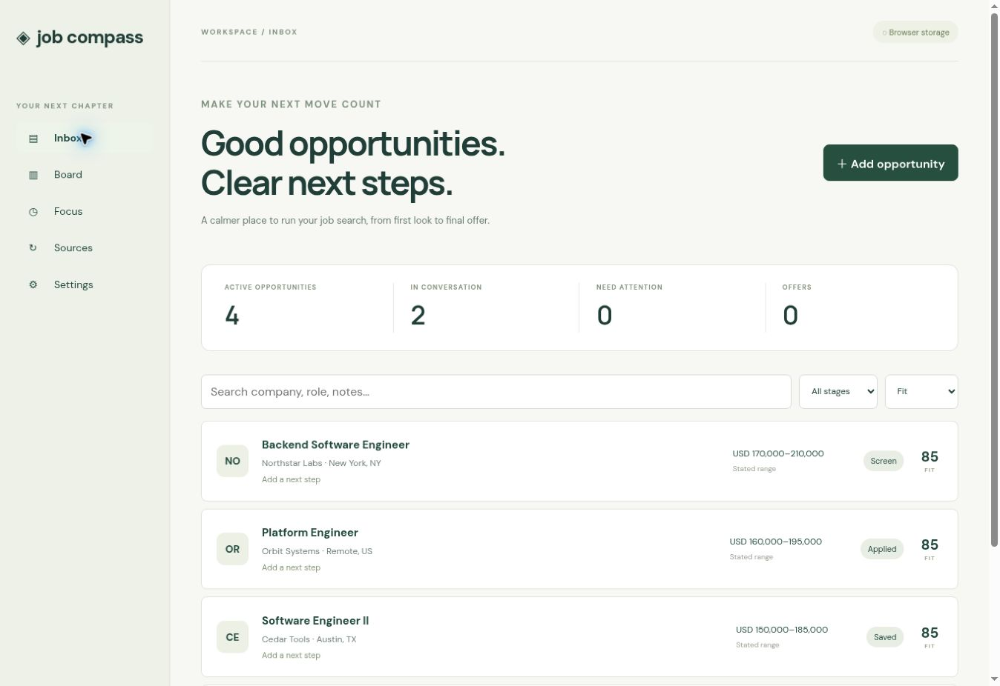

# Job Compass

A job-search workspace: ranked inbox, application board, interview dates, follow-up queue, preparation notes, compensation notes, stage history, JSON backups and CSV export. React/TypeScript UI with a FastAPI/SQLAlchemy backend and PostgreSQL deployment configuration.

## Two operating modes

The hosted Sites edition uses **browser localStorage**. It is usable for manual tracking and backup import/export; it does not synchronize devices or run ingestion. It starts empty; optional sample companies are fictional.

The Docker edition serves the same UI and authenticated API from one origin. It uses PostgreSQL and adds Greenhouse ingestion with bounded retries, deduplication, run history and optimistic concurrency checks. This is a single-user app. Do not expose it publicly without TLS and proper account authentication.

## Run with PostgreSQL

Requires Docker Compose. Create an untracked `.env` with random URL-safe values:

```
POSTGRES_PASSWORD=replace-with-long-random-hex-value
APP_TOKEN=replace-with-another-long-random-hex-value
```

Run `docker compose up --build`. Open `http://localhost:8000`, go to Settings and enter your APP_TOKEN to connect. The port is bound to loopback. Secrets are not shipped in this repository. PostgreSQL persists in the `jobs-data` volume. Initial tables are created on startup; schema migration tooling is a follow-up requirement before future schema changes.

## Run without Docker

```
python -m venv .venv
.venv/bin/pip install -r requirements.txt
npm ci
npm run build
```

Set APP_TOKEN to a random value in your shell. Optionally set DATABASE_URL to a PostgreSQL SQLAlchemy URL; otherwise a local SQLite file is used. Run `.venv/bin/uvicorn backend.main:app --host 127.0.0.1 --port 8000`.

## Ingestion

Connect the server, open Sources and enter a company's Greenhouse board slug. The backend fetches only `boards-api.greenhouse.io/v1/boards/{slug}/jobs?content=true`; arbitrary URL inputs are rejected. It validates the whole response, inserts new jobs transactionally, skips existing source IDs, and never overwrites your notes/stage. Failed requests are recorded and do not mark roles closed. Up to three attempts cover network errors, 429 and selected 5xx responses. Ingestion runs synchronously in a server worker thread; an interrupted process may leave a run marked running. There is no background schedule or automatic application submission.

## Ranking

Rule-based, with visible explanations: engineering title, backend/platform terms, preferred location and a stated USD pay ceiling of $180k. Senior titles, mentions of >3 years and clearance language lower scores. Salary is not inferred from prose, base is not equated with total compensation, and eligibility requires human review. Ranking is not AI-generated.

## Validation

```
.venv/bin/python -m pytest -q
npm test
npm run build
```

Backend tests cover auth, validation, persistence, duplicate submissions, stale edits, history, ingestion deduplication, retries, failures and source URL restrictions. Frontend model tests cover validation, backup deduplication, ranking, follow-ups and CSV formula escaping. API integration tests use isolated SQLite databases; Docker/PostgreSQL is not validated in this environment. Browser QA covers creating/editing opportunities, persistence, board, search and filters. No production personal records are included.

## Current limits

No email/calendar synchronization, automatic applications, paid services, scraping behind logins, multi-user accounts, server-side backup import, or notification delivery. Browser and server datasets remain separate. Back up before clearing browser storage. Follow-up dates drive the Focus view; they do not send reminders.



## Recruiter Radar

The **Radar** tab adds a separate inbox for public LinkedIn hiring-post evidence.
Connect the private API, then scan or paste a public post URL and its text.
Posts persist in the existing jobs table as JSON payloads; no table migration is
needed. Editing a saved opportunity preserves its original radar evidence.
Activity IDs normalize country domains, tracking parameters and alternate URLs
into one source ID, so repeated scans preserve notes and application stages.

Discovery runs six queries across SWE, ML/AI, MLOps and data roles. It defaults
to Bing's public RSS search endpoint (no key). Optionally set
`BRAVE_SEARCH_API_KEY` server-side to use Brave Search's API instead; that service
requires your own credential and may charge for requests. Never put this key in
the frontend or commit it. Search requests have bounded retries and timeouts.
A failed query is recorded as incomplete coverage rather than a negative finding.

**Coverage limitation:** a live Bing RSS smoke check in this implementation
returned HTTP 200 with zero items. Public web search found LinkedIn hiring posts,
but that does not establish that Bing will return them. Brave integration is
covered by the adapter design, not a live credentialed verification. Treat the
free provider as best-effort. Manual post capture is available when indexing
misses something. LinkedIn profile fetches may return status 999; this app never
tries to bypass login, scrape a signed-in feed or send outreach automatically.

Dates are decoded from LinkedIn activity IDs, independent of search crawl dates;
a repost's underlying vacancy may still be older. Automatic scans retain posts
up to 14 days old, and filter to hiring and engineering/data language. Fit scores
are transparent triage heuristics, not eligibility checks. Search snippets do
not establish employer identity, compensation or whether a job remains open;
those remain explicitly unverified until you review the original post/employer.
The app does not automatically resolve employer career links or generate outreach.

To run automatic scans every six hours alongside the private server:

```sh
docker compose --profile radar up --build -d
```

The optional worker stores results and scan history through the authenticated
API. It requires an always-running Docker host. It does not run on the static
Sites edition or send notifications. For a non-Docker server, set
`RADAR_API_ORIGIN=http://127.0.0.1:8000`, `APP_TOKEN`, and optionally
`RADAR_INTERVAL_SECONDS` (minimum 3600), then run
`python -m backend.radar_worker`. Only start one worker per deployment.

Validation covers source URL restrictions, encoded dates/staleness, duplicate
posts, preserved notes/evidence, authentication, and visible search failures.
Docker scheduling and live Brave retrieval require deployment-side validation.
